# Solder

**A lean coding agent beside your editor.** Solder sits in VS Code's side bar and reads, searches and edits the code in your workspace. It talks to any OpenAI-compatible Chat Completions endpoint, such as your company's gateway or a server on your own PC, and to nothing else. Models with tool calling and models without it both work; Solder only needs to know which is which (see [Tool models and Assist models](#tool-models-and-assist-models)).

<p>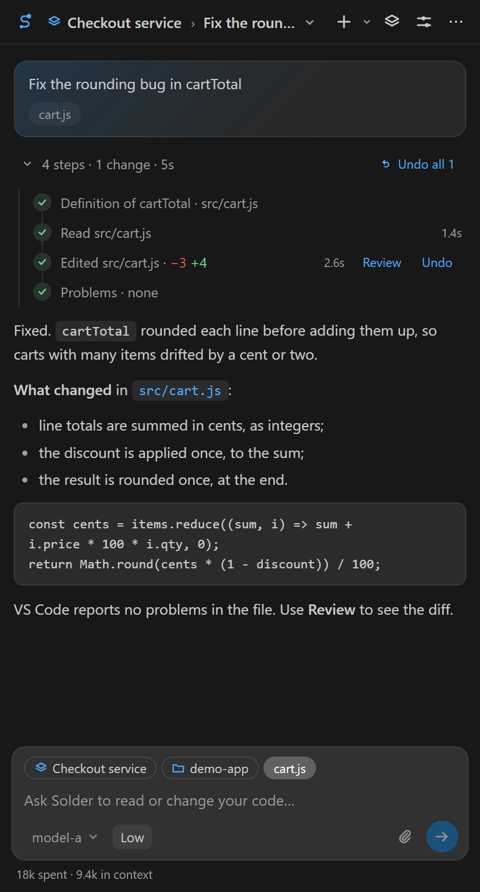</p>

## Tool models and Assist models

**Solder works with two kinds of model, and needs to be told which kind each one is.** Both can read, search and edit your code through Solder's tools. What differs is how they ask for a tool. If Solder has a model down as the wrong kind, the model may answer without ever looking at your files, or say it can't open them: Solder isn't broken, it's one setting.

| | **Tool model** | **Assist model** |
|---|---|---|
| **What it is** | A model the endpoint serves with tool calling (OpenAI-style function calling) | A model the endpoint serves for chat only, without tool calling |
| **What Solder sends** | A system prompt, your messages, and its tools in the request's `tools` array | Your messages only: no `tools` array and no system prompt. Solder's tools and instructions are described in plain words inside your message |
| **How it asks for a tool** | A native tool call in its reply (`tool_calls`) | A short request it writes as text in its reply, which Solder reads and runs |
| **Can it use Solder's tools?** | Yes | **Yes, all of them.** Approvals, Review, Undo, read-only mode, skills and docs work exactly the same |
| **Each step** | Faster; takes a thinking level | A few seconds slower; no thinking level |
| **Typical** | Most OpenAI-compatible APIs, and local servers with function calling turned on | Models a gateway offers for chat without tool calling; some gateways don't count them against a daily allowance |

**Every model starts as a Tool model.** That's right for most endpoints. Change it only for a model your endpoint serves without tool calling.

**Signs a model is set as the wrong kind:**

- **A model without tool calling, left as a Tool model:** it answers in plain prose, says it can't open your files, guesses what a file says, or describes a step without taking it. Mark it as an Assist model.
- **A model with tool calling, set as an Assist model:** it still works, only more slowly and without a thinking level. Mark it as a Tool model.

**How to check and set it:**

- **Check a model:** run **Solder: Check connection** from the Command Palette (**Ctrl+Shift+P**). It asks the model to read a file with a native tool call. *"works, tool calls included"* means a Tool model. *"answered without calling the tool"* means tool calling isn't on for that model: use it as an Assist model.
- **Set it:** **Settings → Advanced → Kinds of model**. Every model starts on the right, as a Tool model; move an Assist model to the left with its arrow. Assist models are tagged **Assist** in the model picker.
- **For organizations:** the `AssistModels` policy lists the Assist models for everyone, or the `ToolModels` policy marks the Tool models by a pattern in their names (see [docs/POLICY.md](docs/POLICY.md)).

More on how Solder runs Assist models: [Assist models in detail](#assist-models-in-detail).

## Built for organizations

**Every setting can be enforced and locked through Group Policy or Intune.**

- **Read-only by default:** Solder starts unable to change files, for policies that want agentic AI read-only unless a user opts in. Enforce it, or turn changes on for everyone.
- **Lock the gateway:** set the address once for every user, and they can't point Solder anywhere else. If the policy can't be read, Solder doesn't connect.
- **Rules for everyone:** add your organization's rules to every user's chats, after their own.
- **Shared docs:** give everyone the same reference folders, with or without folders of their own.
- **Shared skills:** give everyone the same skills, your organization's way of doing a kind of task, from a share.
- **Shared embeddings:** point everyone at one folder, and docs are embedded for search by meaning once, not once per PC.
- **Feedback stays inside:** send **Send feedback** to your own address instead of Solder's support, so nothing about your code leaves by mistake.
- **Ready-made templates:** ADMX and ADML files come with every release. API keys stay with each user, never in policy.

See the [admin guide](docs/POLICY.md) for every setting and how to deploy it.

## Getting started

1. **Install it:**
   - **from the Marketplace:** search for **Solder** in VS Code's Extensions view;
   - **or from a `.vsix` file**, for a PC that can't reach the Marketplace: in the Extensions view, choose **⋯ → Install from VSIX…**, or run `code --install-extension solder-<version>.vsix`.

   Solder needs VS Code 1.100 or later. Docs search also needs SQLite in VS Code's runtime, which recent versions have. If yours doesn't, Settings says so.
2. **Run the guided setup.** Solder offers it the first time it starts. You can also run it any time from the panel's **⋯ menu → Guided setup…**. It asks for:
   - **your gateway's address:** the full Chat Completions URL, ending in `/chat/completions`;
   - **your API key:** kept in VS Code's secret storage, never in settings. Solder checks it by listing the models;
   - **your default model:** if your endpoint serves it without tool calling, mark it as an Assist model afterwards (see [Tool models and Assist models](#tool-models-and-assist-models));
   - **your own docs folders:** optional, see [Your docs](#your-docs);
   - **a few rules about you and your code:** optional, for example "We target Python 3.10" or "Never edit files under `generated/`";
   - **whether Solder may change files:** see [Read-only mode](#read-only-mode).
3. **Ask.** Type in the box at the bottom and press **Enter**; **Shift+Enter** adds a new line. Or pick one of the cards on a new chat: summarise the codebase, explain or fix a script, clean up, learn something, review your changes, or ask what Solder can do.

<p>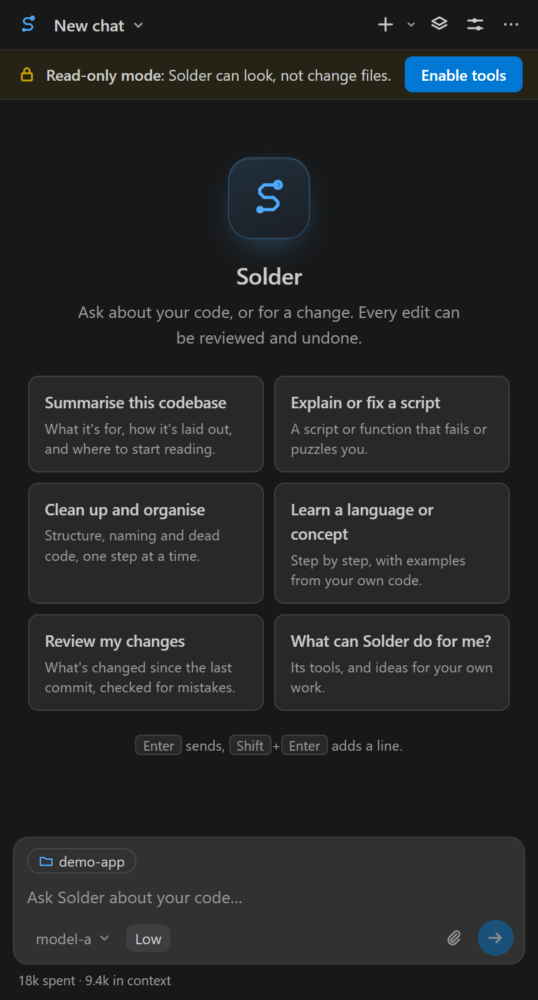 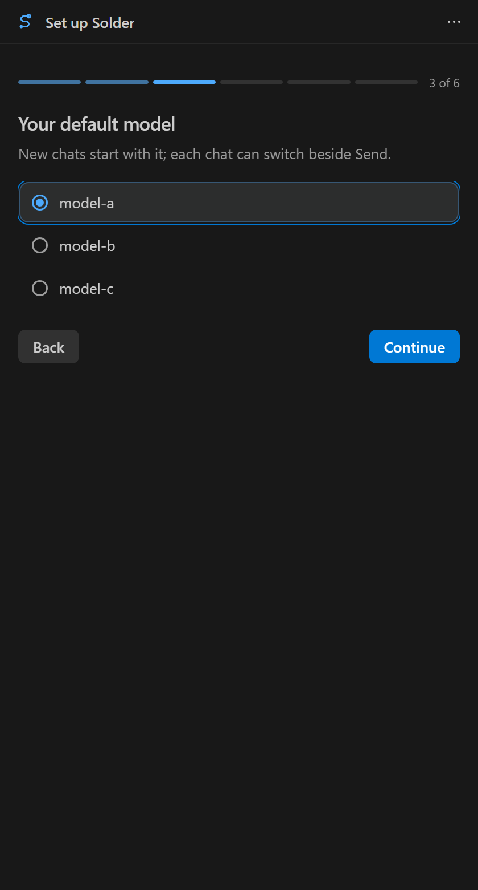</p>

## Read-only mode

**Solder starts in read-only mode.** It reads, searches and explains your code, but it can't create, edit, move or delete files: the tools that change files aren't offered to the model, and aren't run if it asks for one anyway. When a task needs a change, it shows you what to change instead.

- **Turn changes on** with **Enable tools** in the strip at the top of the panel, in the guided setup, or in **Settings → Connection → Changes**. It's a one-time choice: Solder never goes back to read-only mode by itself. You can turn it back on in Settings.
- **For organizations:** the `ReadOnly` policy keeps every user in read-only mode, or turns changes on for everyone (see [docs/POLICY.md](docs/POLICY.md)).
- **Already using Solder?** If you had set it up before read-only mode came in, changes stay on.

## Using Solder

- **What it looks at.** Chips above the box tell Solder where you are:
  - **The working folder:** relative paths and searches start there. Click the chip to change it, or right-click a folder in the Explorer and choose **Solder: Work in this folder**.
  - **Several folders:** every folder in the window counts as the workspace (add one with **File → Add Folder to Workspace…**): Solder searches them all and edits in any of them without asking. Pick a folder that isn't in the window as the working folder and Solder offers to add it. Your chats follow their folder, so they're there whichever window you open it in.
  - **The open file, or your selection:** click a chip to include it, or click it again to leave it out.
- **While it works,** each step shows as a line with how long it took. Click a line to see its output. If you type something meanwhile, the message is **queued** and goes with the next step. Its ✕ takes it back.
- **From the editor:** select some code, right-click, and choose **Solder → Explain this**, **Fix this** (it sends the problems VS Code shows in the selection too) or **Add to chat** (the selection goes with your next message).
- **Attach text files, and long pastes.** The paperclip beside **Send** attaches text files (logs, scripts, config; Word, Excel and PowerPoint as their text). Each shows as a chip above the box and goes with your next message; ✕ takes it off, and a click shows what's in it. A file up to about 40,000 characters is sent whole; a longer one goes by its path, and Solder reads just the parts it needs. All that's attached to one message goes whole only up to about 40,000 characters together: past that, the rest goes by path too (a paste is saved in Solder's own storage first). Each chip shows what it will cost, as about how many tokens or **by path**: text sent whole is sent again with every step of the task. Text you paste that's over 40 lines becomes a chip the same way, so a long log stays out of the box and out of the chat's scroll.
- **File names in an answer** are links: click one to open the file. Right-click it (or press **Shift+F10**) to copy the name, copy its full path, open it, or show it in the file explorer.
- **Paste in terminal.** A command in an answer, in a PowerShell, bash or cmd code block, has **Paste in terminal** beside **Copy**: it goes into VS Code's terminal for you to check and run with **Enter**. Solder never runs it for you. A block of several lines asks first: some terminals (Windows PowerShell among them) run each pasted line as it arrives, without waiting for Enter. The question has a second button, **Paste, and don't ask again in this chat**, which stops it for that chat alone.
- **Every edit can be reviewed and undone.** **Review** opens VS Code's diff of that step. **Undo** puts the file back as it was, and Solder is told with your next message. Once a turn is done, its steps fold into one row: click it to see them. When a turn changed two or more things, **Undo all** on that row puts every one back, after asking; a file you've changed since is left alone. VS Code's own **Ctrl+Z** works too.
- **It asks first** before:
  - deleting anything;
  - changing a file outside the workspace, or one with unsaved changes;
  - changing git's or VS Code's own files (`.git`, `.vscode`, `.gitattributes`, a `.code-workspace` file), where a change can make programs run;
  - changing a rules file (`AGENTS.md`) or anything in a project's `.solder` folder, which later chats follow;
  - reading a file outside the workspace and your docs and skills folders.

  You can add a note for the model when you answer.
- **Slash commands.** Type **/** in the box for the list; the arrow keys move, **Enter** or **Tab** picks one, **Esc** closes it:
  - **/new** starts a new chat (in no project), and **/fork** carries on in a copy of this one (the original stays as it was);
  - **/compact** summarises the chat now to save tokens; add what matters most, as in `/compact the API names`;
  - **/rename**, **/model** and **/effort** change this chat's name, model or effort, as in `/effort high`;
  - **/review** reviews what's changed since the last commit;
  - **/skill** saves how this chat's task was done as a skill, for next time; add what it's for to have one written from that, as in `/skill how we name branches` (see [Skills](#skills));
  - **/settings** opens the settings (`/settings skills` opens them at that tab); **/help** opens this guide.
- **Edit or delete a message.** Point at one of your messages for the pencil and the bin at its bottom-right. **Delete** takes that message and its reply out of the chat, after asking. **Edit** takes it and everything after it, and puts your words back in the box to fix and send again. Files Solder changed stay as they are: only the conversation forgets. A message that's been summarised can't be changed.
- **Stop and Resume.** **Stop** (or **Esc**) ends the reply. After a stop, or a connection problem, **Resume** carries on from the last finished step, so nothing that's done is lost.
- **Models and effort.** The model picker beside Send switches models for this chat. **Low / Medium / High** sets how hard the model thinks: High is slower and uses many more tokens.
- **Settings** (the sliders button in the bar, or **/settings**) open right in the panel, in five tabs: **Connection** (the gateway, your key, the default model and effort), **Docs / RAG** (your docs folders, and how far indexing has got), **Skills**, **Rules** (your rules and instruction files) and **Advanced** (cost, which models are offered and which kind each is, and Undo's storage). Each field saves as you leave it, and **Done** stays in the bar at the top. A dot on a tab means something there wants a look. Solder's version is at the top right of every tab.
- **While Solder works,** you can open other chats from the title menu to read them. A banner says where it's working, or that it needs your approval or has finished, with a button back to it. New messages wait until it's done.
- **Chats** are saved per workspace. The title menu lists them: pinned ones first, then by age (today, the last 7 days, the last 30 days, older), with archived ones folded away at the end. With [projects](#projects), the list is grouped: the project you're in, your other projects (folded until you click one), then **Other chats**. **Right-click** a chat there (or press **Shift+F10**) to pin, rename, fork, archive or delete it. Solder names each chat after its first answer, and again after the third; a name you give it is kept.
- **New chat.** **+** in the bar starts a chat in no project; the arrow beside it starts one in a project of yours, or makes a new project.

<p>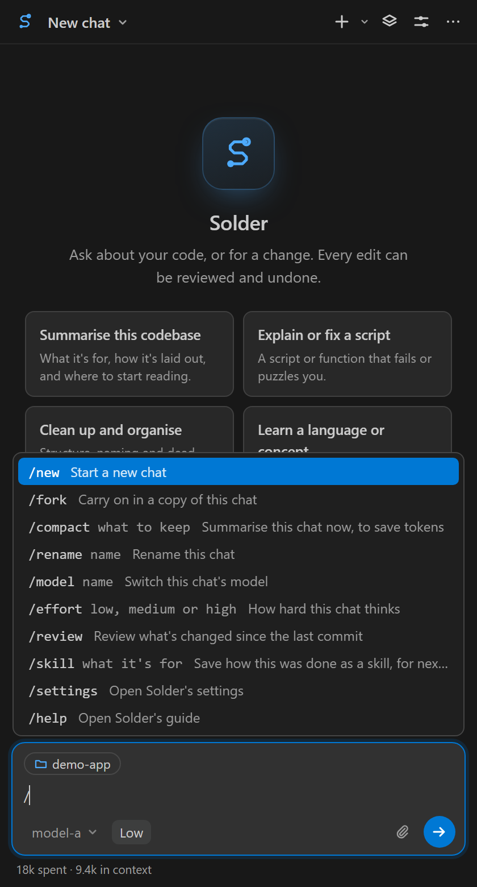 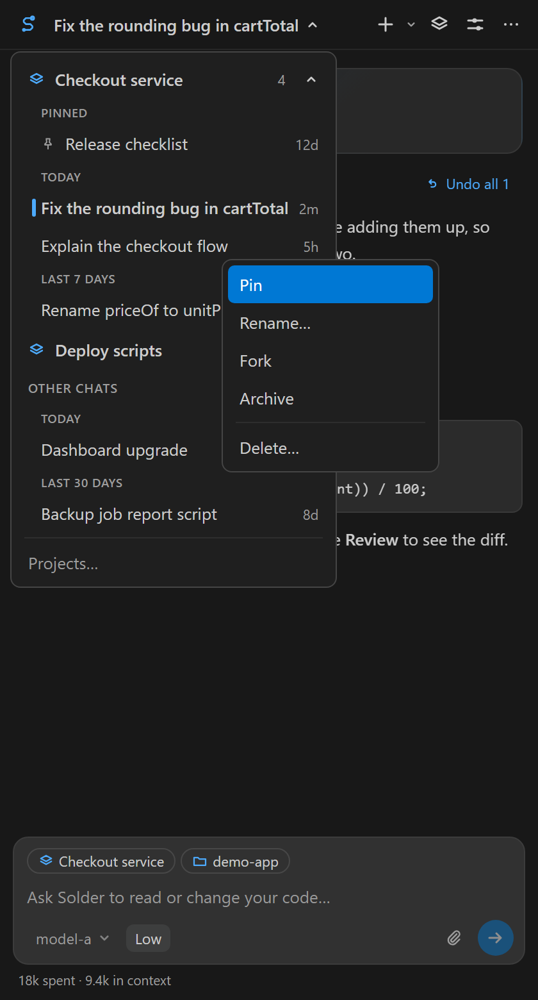</p>

## What it can do

Solder has ten tools, and no shell. It never runs commands: when something needs building or testing, it says what to run, and you run it.

| Tool | What it does |
|---|---|
| `read_file` | Reads a file, or a range of lines. It sees unsaved changes, and reads Word, Excel and PowerPoint files as text. |
| `symbols` | A file's outline (classes, functions, methods), or where a name is defined and every place it's used, from VS Code's language support. |
| `search` | Searches the workspace, or your docs folders. |
| `find_files` | Lists files matching a pattern. |
| `changes` | Shows what's changed in git since the last commit. |
| `edit_file`, `write_file` | Changes or writes a file (creating any folders it needs), then reports any new errors VS Code finds in it. |
| `move_item` | Moves, renames or copies a file or folder, creating any folders it needs. It never overwrites, and lists the lines that still use the old path so they get fixed. It can be undone. |
| `remove_item` | Deletes a file or folder, after asking. It can be undone. |
| `problems` | Lists the errors and warnings VS Code shows. |

## Your docs

Point Solder at folders of reference documentation that only exist on your PC: in-house APIs, schematics, specifications. The model then searches them when a task needs them.

- **Add a folder:** in the guided setup; with **Use as Solder docs** on a folder in the Explorer; or in the **Docs folders** setting. Each folder can have a short note on what's in it, which tells the model when to look there.
- **What's searched:**
  - any plain text: `.txt`, `.md`, `.rst`, `.html`, `.xml`, `.json`, `.yaml`, `.csv`, `.log`, and code and headers such as `.c`, `.h`, `.py`, `.cs` and `.ps1`, in UTF-8 or UTF-16;
  - Word, Excel and PowerPoint files: `.docx`, `.xlsx`, `.pptx`, and their macro versions.
- **What isn't:**
  - PDFs, images and scans;
  - the old `.doc`, `.xls` and `.ppt` formats;
  - files over 5 MB (40 MB for Office files);
  - anything beyond 20,000 files in one folder. `.git` and `node_modules` are skipped.
- **Privacy:** the index is built and kept on your PC, and refreshed in the background. Only the passages the model reads are sent to your endpoint.
- **Search by meaning (optional):** in **Settings → Docs / RAG**, choose **Keywords + meaning** and your gateway's embeddings model (**Test** checks it). Searches then also find passages that say the same thing in other words, merged with the keyword results. It sends every passage of your docs folders to the gateway once, to be turned into numbers, then only changed files, plus each search's words. The log (**⋯ → Copy diagnostics**) shows the tokens each run used.
- **Start and Stop:** a big embedding run (300 passages or more) waits for you to press **Start embedding** in **Settings → Docs / RAG**, which shows how many passages and about how many tokens it is. It then carries on in the background, over several days if the daily budget makes it. **Stop embedding** holds it until you start it again; what's already embedded is kept and used.
- **Pace:** embedding sends at most 250,000 tokens a minute, so a big folder goes at a steady pace under what a gateway allows each minute. Change it with **Pace** in **Settings → Docs / RAG** (0 for no limit).
- **Near enough in meaning:** a passage counts only when it's at least so similar to your question, so a question about nothing in the docs brings back nothing by meaning (keywords still answer). The floor is a similarity of 0.58. Embeddings models score on their own scales, so the log (**⋯ → Copy diagnostics**) shows each search's best similarity; set **Meaning floor** to tune it for your model.
- **Sharing embeddings (optional):** embedding the same docs on every PC costs the same tokens every time. Set **Shared embeddings folder** (in **Settings → Docs / RAG**, under the embeddings model) to a folder your team shares, such as a network share. What one PC has embedded is put there, and the others take it from there: no tokens, nothing against the daily budget, and no waiting for it. A file's embeddings are used only where the file's text is exactly the same, with the same embeddings model; a file that changed is embedded again by whoever has it first. The folder holds numbers only, no text and no file names, but they're derived from your docs, so share it only with people who may read them. If the folder can't be reached, Solder embeds through the gateway as before. Admins can set it for everyone with the `EmbeddingsCache` policy.
- **A daily budget for it:** embedding counts against the same daily allowance as the models, so it's held to a budget of its own, 250,000 tokens a day by default (the gateway's day, from midnight UTC). Past it, embedding waits for the next day, and keyword search, and meaning over what's already embedded, go on. Change it under **Daily budget**, or **raise it for today** once it's reached. A gateway on your own PC isn't counted. Organizations can set it with the `EmbedDailyBudget` policy.

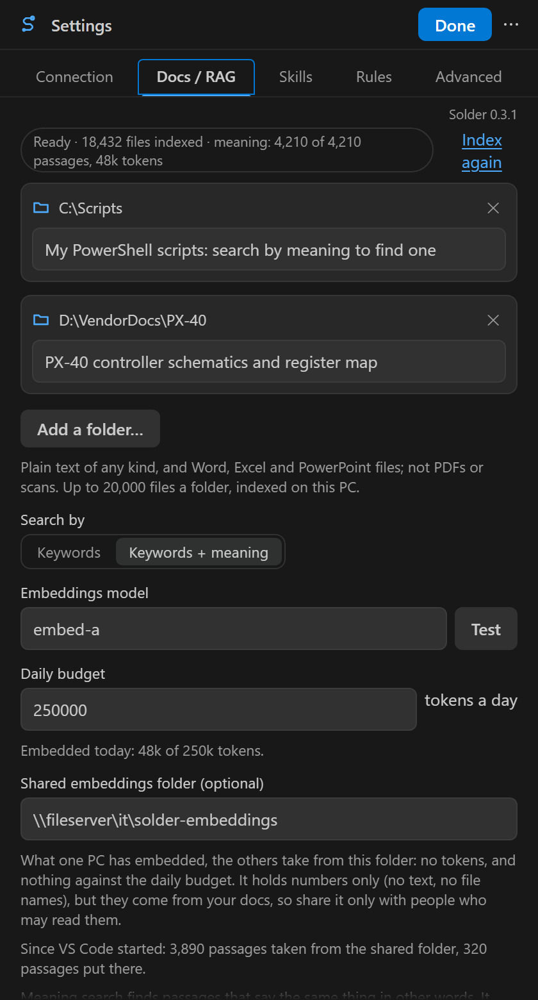

## Skills

A skill is your instructions for a kind of task: how you write PowerShell scripts, review a change, or add an API endpoint. The model is told what skills you have, and reads one whole before starting a task it covers.

- **What one looks like:** a Markdown file, named after the skill (`ps_scripts.md`). Its first line says when to use it; the instructions follow:

  ```markdown
  When to use: Writing or changing a PowerShell script.

  - Target Windows PowerShell 5.1: no ternaries, no ?? or ?. operators.
  - Use approved verbs (Get-, Set-, New-...) and full cmdlet names, not aliases.
  - Every script starts with a comment block saying what it does and how to run it.
  ```

  A file that starts with a front-matter block instead (`---`, then `description: ...`, then `---`), as Claude's and Codex's `SKILL.md` files do, works too: its description says when to use it.
- **Making one:** in **Settings → Skills**, **New skill…** opens a short form there: its name, and when the model should use it. **Create** makes it and opens it in the editor for you to write the instructions (**Solder: New skill** in the command palette opens the same form). Click a skill to edit it, or ✕ to delete it. Changes count from your next message.
- **Switching one off:** each of your skills has a switch in **Settings → Skills**. Off, the model isn't told about the skill; the file stays where it is. A project's page has its own switches, to have a skill on or off in that project alone (see [Projects](#projects)). Your organization's skills are always on.
- **Not sure how to write it?** Choose **I have an idea for a skill, but I don't know how to write it** in **Settings → Skills**. Solder asks you a few questions at a time, shows you a draft, and saves it once you say it's right.
- **Where they're kept:** in `Solder\skills` in your AppData folder (`%APPDATA%`), which the guided setup makes. To use a folder you already have, choose **Use a folder of skills…** in Settings, or right-click it in the Explorer and choose **Use as Solder skills**. New skills go in the first folder.
- **Saving one from a chat:** after a task you'll do again, type **/skill**. Solder writes up how the task was done as a skill, and asks before it saves the file. `/skill` followed by what it's for (`/skill how we name branches: feature/<ticket>-<slug>`) writes one from that instead. You can also just ask in your own words.
- **The rules:**
  - one `.md` file per skill, directly in a skills folder (subfolders aren't read);
  - no scripts or other files: Solder doesn't run anything, so a skill is instructions only;
  - keep each to a page or two: the model reads up to 20,000 characters of one, and at most 50 skills are offered.
- **How the model uses them:** it sees one line per skill (its name, file and when to use it). Before a task one covers, it reads that skill, and the skill then stays in the chat for the rest of the task, even when older results are cut. Reading your skills folders never needs your approval; changing a skill does. A file with no "When to use" line isn't offered to the model (so a README in the same folder isn't mistaken for a skill), and Settings says so.
- **For organizations:** the `SkillsFolders` policy gives everyone the same skills, from a share if you like; `AllowUserSkills` lets users add folders of their own beside them. See the [admin guide](docs/POLICY.md).

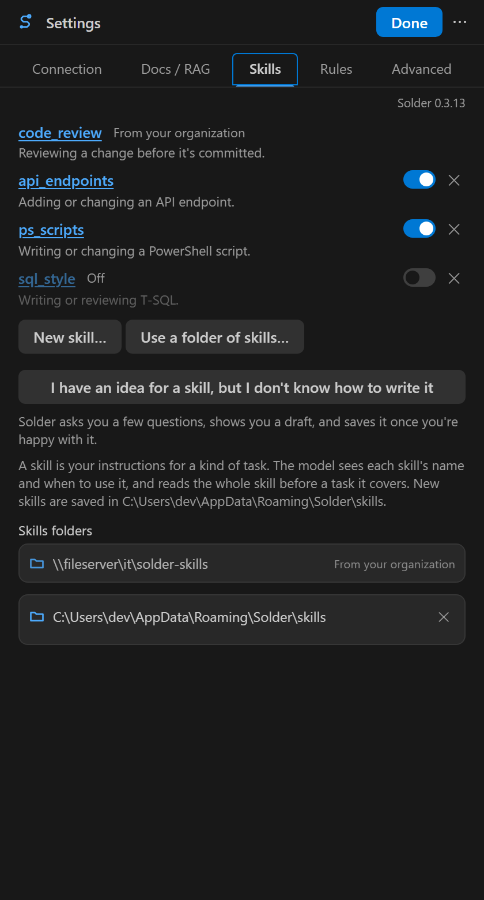

## Projects

A project is a folder you work in, with its own rules, skills and chats. Everything that makes it a project is kept in the folder itself, so it can be shared by copying the folder.

- **Making one:** the **Projects** button at the top of the panel (or **Projects…** at the end of the chats list) opens the Projects screen. **New project…** asks for the folder. Solder adds a small `.solder` folder to it, holding the project's name and its skills.
- **Its chats:** the arrow beside **+** at the top of the panel starts a new chat in a project of yours (**+** itself starts one in no project); so does **+** beside a project on the Projects screen. A project's chat works in the project's folder, follows its rules and is offered its skills.
- **Finding them:** the chats list at the top of the panel is grouped by project: the project you're in comes first, your other projects are folded under it (click one to open it), and chats in no project are under **Other chats**. Each group is sorted as before: pinned first, then by age. The Projects screen lists every project with its chats too.
- **Where you are:** in a project's chat, the project's name shows before the chat's title at the top of the panel (`Work › Fix the build`). A chat with no name there is in no project.
- **Its page:** the arrow beside a project (or the project's name at the top of the panel) opens its page, where you can read all of it:
  - **Rules:** the project's `AGENTS.md`, shown in full. **Edit** opens it in the editor; **Create AGENTS.md** makes one if it has none.
  - **Skills:** the project's own skills, in `.solder\skills`. Click one to read it; **Edit**, **Delete** and **New skill…** work as in Settings. Only this project's chats are offered them, beside your own skills.
  - **Your skills in this project:** your own skills, each with a switch for this project alone: switch off one that doesn't fit here, or switch on one you keep off everywhere else. The project's own skills have switches too. The switches are kept in the project's folder, so they travel with it.
  - **Name:** change it there. The folder isn't renamed.
- **The folder is the project:** the code, its `AGENTS.md` and the small `.solder` folder together. Nothing needs moving into `.solder`: that folder only holds the project's name, skills and switches.
- **Sharing one:** **Export…** on the project's page writes one zip named after the project, with either the project's own files (for someone who has the code already) or the whole folder, code included. The whole-folder export leaves out git's history and `node_modules`, and asks first: check the folder holds nothing you wouldn't hand over. Copying or zipping the folder yourself works just as well. Its rules, its skills and its skill switches come along. Whoever gets it opens the folder in VS Code, and the Projects screen offers it with **Use it…**. Chats aren't in the folder: they stay on your PC.
- **A project from someone else:** its rules and skills are instructions the model follows, so Solder asks before using a folder that's already set up as a project, and uses nothing from it until you say yes. A project can't change your settings, what needs approval, or read-only mode; its skill switches only decide which skills its own chats are offered, and your organization's skills stay on.
- **Removing one:** **Remove from my projects** on its page takes it off your list. The folder, its rules and its skills stay as they are, and its chats move to **Other chats**.
- **For organizations:** when the `SkillsFolders` policy sets the skills and users can't add their own, a project's skills aren't used either.

<p>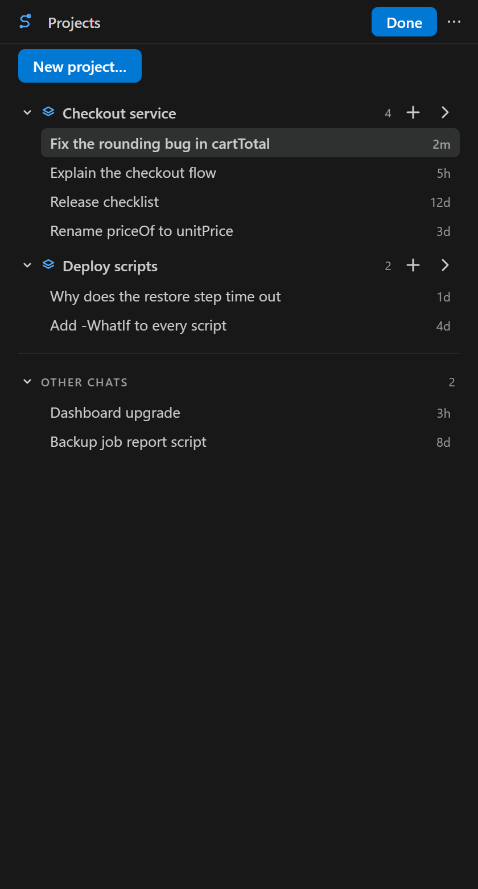 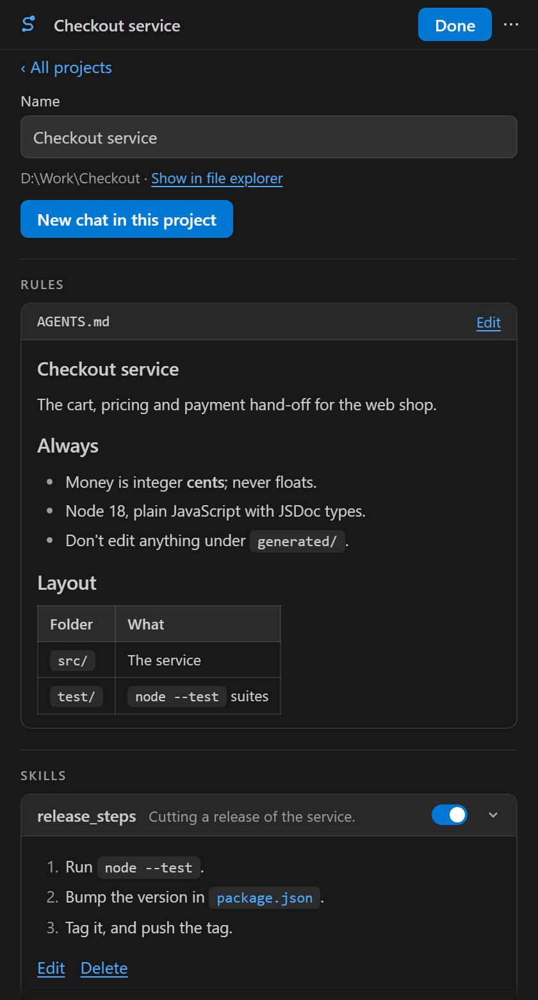</p>

<p>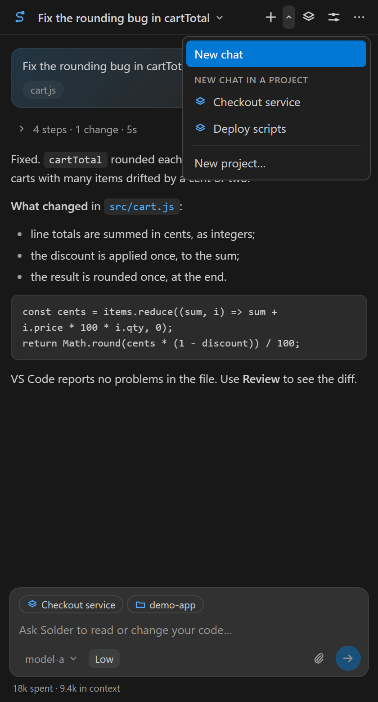 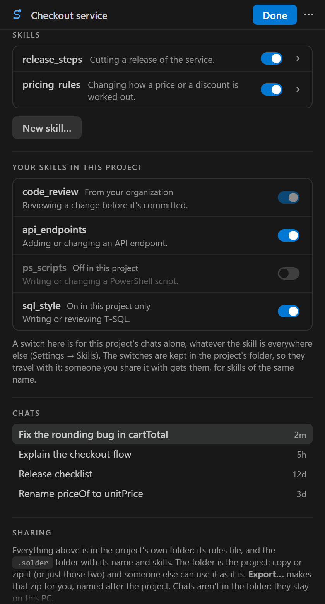</p>

## Assist models in detail

What an Assist model is, and how to tell Solder which models are, is at the top: [Tool models and Assist models](#tool-models-and-assist-models). How Solder runs them:

- **Tell them apart:** in **Settings → Advanced → Kinds of model**, every model starts on the right as a Tool model; move an Assist model to the left with its arrow (**Refresh models** asks the gateway for the list). Assist models are tagged **Assist** in the picker. Admins can set the list by policy (`AssistModels`), or a pattern (**Tool models**, under *For admins*).
- **How Assist models work in Solder:** no `tools` array and no system prompt are sent. Solder tells them about your workspace and its tools in plain words, in your message, and they ask for a tool by writing a short request in their reply, which Solder runs as it runs a native tool call. Several requests can go in one reply. Steps, approvals, Review and Undo work the same. Assist models take no thinking level.
- **They're held back less:** an Assist model's tokens usually aren't billed, so Solder doesn't trim or summarise their chats by itself, and lets a message take more steps (**Assist max rounds**, 60) than on a Tool model (**Max rounds**, 30). They still have a limit to what they can hold: `/compact` summarises a long chat when you want it to.
- **A reply that's cut off carries on by itself:** when an Assist model's reply stops partway (the stream ends early, the connection drops), Solder keeps what arrived and asks it to carry on, once, as **Resume** would. If that's cut off too, the error is shown with **Resume**, as before.
- **Carry-over:** when a whole conversation has to go to an Assist model in one request (a chat switched to one, a session that ended, or a gateway that keeps none), Solder sends as much of it as **Assist carry-over tokens** allows (200,000), newest first. Set it well inside what your Assist models can hold.
- **Sessions:** if your gateway keeps Assist conversations in a session, set **Assist session block** to the name of the object its responses carry it in. Solder then sends only each new message.
- **Switching:** a chat can move between the two at any point. If your Tool models' daily allowance runs out mid-task, Solder offers to switch the chat to the Assist version of the same model and carry on.

## Instructions it follows

- **`AGENTS.md`:** a plain text file you write yourself, in a project's top folder, saying what the model should always know about that project. It isn't made for you: **Settings → Rules → Create AGENTS.md** makes one to fill in. If your workspace has one at its root, Solder follows it. One in a subfolder applies once Solder reads files there. The **Instruction files** setting adds others, such as `CLAUDE.md`.
- **Your rules:** a few plain lines in the **Rules** setting, or in the guided setup, added to every chat.
- **Your skills:** instructions for particular kinds of task, read only when a task needs them (see [Skills](#skills)).

## Tokens and cost

Each step sends the whole chat again, so long chats cost more per step. Solder keeps that down:
- it cuts old tool output down to short stand-ins;
- it leaves out earlier turns' big file writes;
- when a file is read again in the same task, it keeps the newer copy and cuts the older to a line;
- what you attach goes whole only up to about 40,000 characters a message, and by its path past that;
- it summarises the older part of a chat once it passes **Compact at tokens**, 100,000 by default;
- when a Tool model has an Assist twin (see [Assist models in detail](#assist-models-in-detail)), the twin writes those summaries and the chats' titles, so they don't use your allowance and still work once it's used up.

Under the box, the chat shows what it has **spent** (every request added up) and how much is **in context** (what each step sends now, as your gateway counted it): older turns are summarised once that passes **Compact at tokens**. The status bar shows the allowance left when your gateway reports one. **A new chat for each new task is the cheapest habit.**

**Where a chat's tokens went:** **⋯ → Copy diagnostics** breaks them down, in numbers only: how many requests, tokens in and out, and what the tokens in carried over every request (tool results, the system prompt, the tool definitions, thought signatures and so on). It also shows what the next request holds, and how often a file was read again while its first read was still in the chat.

## Settings

| Setting | What it's for |
|---|---|
| **Endpoint** | your gateway's `/chat/completions` address |
| **Model**, **Model filter**, **Model names** | the default model; which models are offered; short names for the picker |
| **Read only** | read-only mode (on until you turn changes on; see [Read-only mode](#read-only-mode)) |
| **Effort** | how hard new chats think |
| **Compact at tokens** | when the older part of a chat is summarised |
| **Max rounds** | the most steps with tool calls for one message |
| **Assist max rounds**, **Assist carry-over tokens** | the same limit for chats on an Assist model, and how much of a conversation is carried over to one in a single request (see [Assist models in detail](#assist-models-in-detail)) |
| **Rules**, **Instruction files** | what the model always follows |
| **Docs folders** | your own reference docs |
| **Embed tokens per minute** | the most sent to the embeddings model in a minute (**Pace**), 250,000 by default; `0` for no limit |
| **Meaning floor** | how similar a passage must be to a docs search to count; `0` uses Solder's own, 0.58 |
| **Shared embeddings folder** | a folder where PCs share docs embeddings, so the same docs aren't embedded by everyone (see [Your docs](#your-docs)) |
| **Skills off** | the skills you've switched off (the switches in **Settings → Skills**) |
| **Skills folders** | your skills (see [Skills](#skills)); a new one is saved in the first |
| **Tool models**, **Assist session block** | which models are Tool models, and where an Assist model's session comes (see [Assist models in detail](#assist-models-in-detail)) |
| **Storage limit GB** | the most disk space Undo's backups may use, 5 GB by default; past it, the oldest go first |

The API key is set with **Solder: Set API key**, or in the guided setup. It's never stored in settings.

**For organizations:** every setting can be enforced with Group Policy or Intune, and locked for users. Most organizations enforce the gateway address, and some add rules of their own for every user. The templates and guide are in [docs/POLICY.md](docs/POLICY.md).

## Privacy

- **Network:** Solder contacts only the endpoint you set. There's no telemetry, no update check and no other network call, and the panel loads nothing from the internet. **⋯ → Send feedback…** opens your own email app, addressed to support (or to your organization's own address, when it sets one), with only the Solder and VS Code versions filled in.
- **Your key:** kept in VS Code's secret storage, and sent only to the gateway it was saved for. Change the gateway's address and Solder asks for that gateway's key.
- **Your chats and the docs index:** stay on your PC, in VS Code's storage for Solder.
- **A project's rules, skills and skill switches:** are in the project's own folder, so they go wherever you copy it. Its chats don't.
- **The shared embeddings folder (off unless you set one):** holds numbers derived from your docs, with no text and no file names. Share it only with people who may read those docs.

## Troubleshooting

- **"Can't reach the endpoint":** run **Solder: Check connection** from the command palette. It lists the models, then makes one tool round trip, and reports each step in the Solder output.
- **"The allowance is used up":** your gateway's daily limit was reached. Everything so far is saved, so choose **Resume** once it resets.
- **A project's chat doesn't follow its rules or skills:** the project must be on your list (the Projects screen shows it; **Use it…** takes on one that's found in the window), and a skill must be switched on, in **Settings → Skills** or on the project's page.
- **The shared embeddings folder isn't used:** **Settings → Docs / RAG** says why under the field. It needs a full path you can read and write; when it can't be reached, Solder embeds through the gateway as before.
- **The outline or symbols come back empty:** VS Code has no language support for that kind of file, or it's still starting. Solder falls back to text search.

## Contributing

See [CONTRIBUTING.md](CONTRIBUTING.md). To report a security problem, see [SECURITY.md](SECURITY.md). Solder is MIT licensed, and what's changed is in [CHANGELOG.md](CHANGELOG.md).
