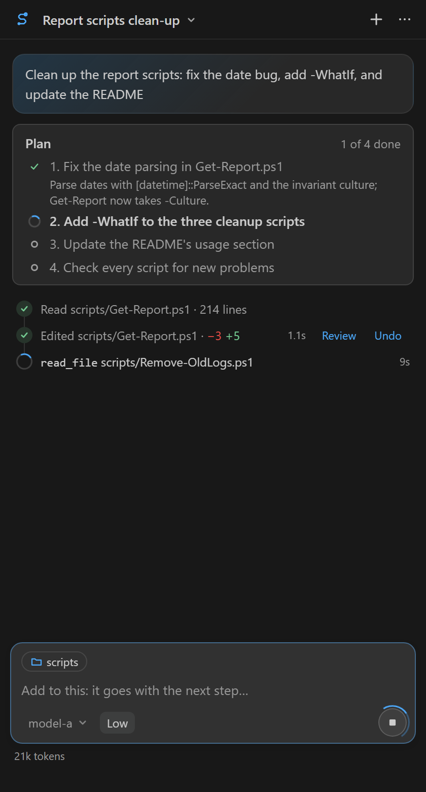
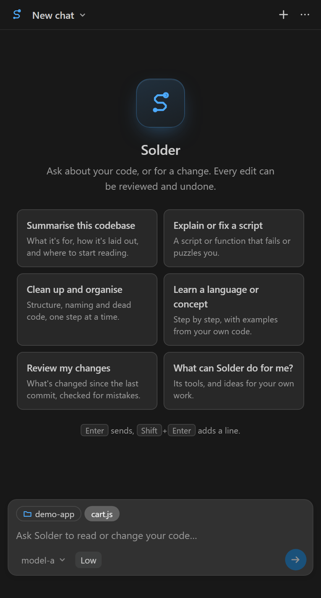
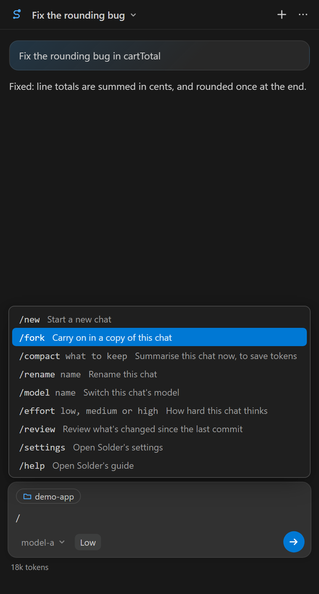
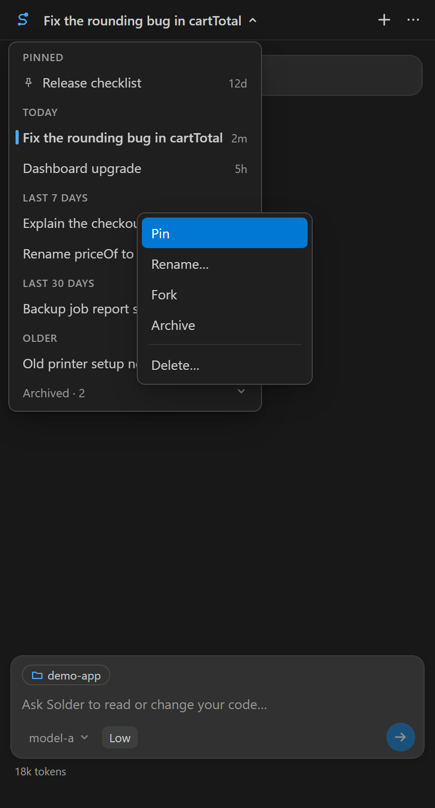
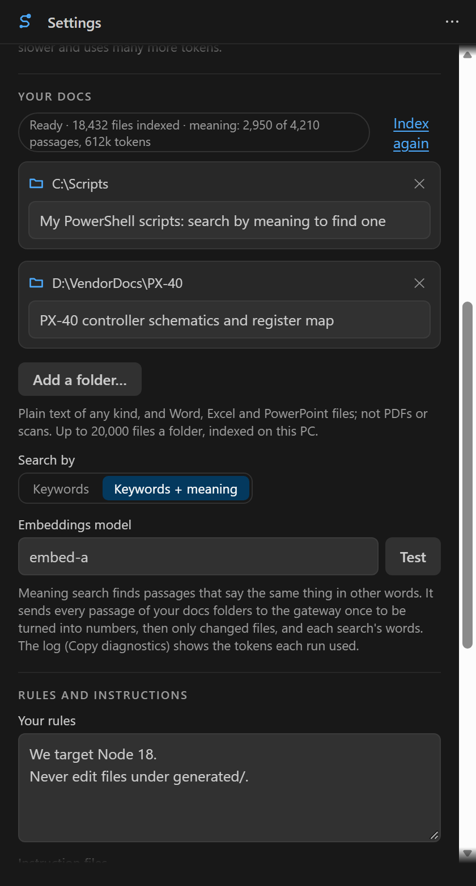

# Solder

**A lean coding agent beside your editor.** Solder sits in VS Code's side bar and reads, searches and edits the code in your workspace. It talks to any OpenAI-compatible Chat Completions endpoint that supports tool calling, such as your company's gateway or a server on your own PC, and to nothing else.

<p> </p>

## Built for organizations

**Every setting can be enforced and locked through Group Policy or Intune.**

- **Lock the gateway:** set the address once for every user, and they can't point Solder anywhere else. If the policy can't be read, Solder doesn't connect.
- **Rules for everyone:** add your organization's rules to every user's chats, after their own.
- **Shared docs:** give everyone the same reference folders, with or without folders of their own.
- **Shared skills:** give everyone the same skills, your organization's way of doing a kind of task, from a share.
- **Feedback stays inside:** send **Send feedback** to your own address instead of Solder's support, so nothing about your code leaves by mistake.
- **Ready-made templates:** ADMX and ADML files come with every release. API keys stay with each user, never in policy.

See the [admin guide](docs/POLICY.md) for every setting and how to deploy it.

## Getting started

1. **Install it:**
   - **from the Marketplace:** search for **Solder** in VS Code's Extensions view;
   - **or from a `.vsix` file**, for a PC that can't reach the Marketplace: in the Extensions view, choose **⋯ → Install from VSIX…**, or run `code --install-extension solder-<version>.vsix`.

   Solder needs VS Code 1.100 or later. Docs search also needs SQLite in VS Code's runtime, which recent versions have. If yours doesn't, Settings says so.
2. **Run the guided setup.** Solder offers it the first time it starts. You can also run it any time from the panel's **⋯ menu → Guided setup…**. It asks for:
   - **your gateway's address:** the full Chat Completions URL, ending in `/chat/completions`;
   - **your API key:** kept in VS Code's secret storage, never in settings. Solder checks it by listing the models;
   - **your default model;**
   - **your own docs folders:** optional, see [Your docs](#your-docs);
   - **a few rules about you and your code:** optional, for example "We target Python 3.10" or "Never edit files under `generated/`".
3. **Ask.** Type in the box at the bottom and press **Enter**; **Shift+Enter** adds a new line. Or pick one of the cards on a new chat: summarise the codebase, explain or fix a script, clean up, learn something, review your changes, or ask what Solder can do.

<p> </p>

## Using Solder

- **What it looks at.** Chips above the box tell Solder where you are:
  - **The working folder:** relative paths and searches start there. Click the chip to change it, or right-click a folder in the Explorer and choose **Work in this folder**.
  - **Several folders:** every folder in the window counts as the workspace (add one with **File → Add Folder to Workspace…**): Solder searches them all and edits in any of them without asking. Pick a folder that isn't in the window as the working folder and Solder offers to add it. Your chats follow their folder, so they're there whichever window you open it in.
  - **The open file, or your selection:** click a chip to include it, or click it again to leave it out.
- **While it works,** each step shows as a line with how long it took. Click a line to see its output. If you type something meanwhile, the message is **queued** and goes with the next step. Its ✕ takes it back.
- **From the editor:** select some code, right-click, and choose **Solder → Explain this**, **Fix this** (it sends the problems VS Code shows in the selection too) or **Add to chat** (the selection goes with your next message).
- **Every edit can be reviewed and undone.** **Review** opens VS Code's diff of that step. **Undo** puts the file back as it was, and Solder is told with your next message. Once a turn is done, its steps fold into one row: click it to see them. When a turn changed two or more things, **Undo all** on that row puts every one back, after asking; a file you've changed since is left alone. VS Code's own **Ctrl+Z** works too.
- **It asks first** before:
  - deleting anything;
  - changing a file outside the workspace, or one with unsaved changes;
  - changing git's or VS Code's own files (`.git`, `.vscode`, `.gitattributes`), where a change can make programs run;
  - reading a file outside the workspace and your docs and skills folders.

  You can add a note for the model when you answer.
- **Slash commands.** Type **/** in the box for the list; the arrow keys move, **Enter** or **Tab** picks one, **Esc** closes it:
  - **/new** starts a new chat, and **/fork** carries on in a copy of this one (the original stays as it was);
  - **/compact** summarises the chat now to save tokens; add what matters most, as in `/compact the API names`;
  - **/rename**, **/model** and **/effort** change this chat's name, model or effort, as in `/effort high`;
  - **/review** reviews what's changed since the last commit;
  - **/skill** saves how this chat's task was done as a skill, for next time; add what it's for to have one written from that, as in `/skill how we name branches` (see [Skills](#skills));
  - **/settings** opens the settings (`/settings skills` opens them at that tab); **/help** opens this guide.
- **Stop and Resume.** **Stop** (or **Esc**) ends the reply. After a stop, or a connection problem, **Resume** carries on from the last finished step, so nothing that's done is lost.
- **Models and effort.** The model picker beside Send switches models for this chat. **Low / Medium / High** sets how hard the model thinks: High is slower and uses many more tokens.
- **Settings** (⋯ → Settings) open right in the panel, in five tabs: **Connection** (the gateway, your key, the default model and effort), **Docs** (your docs folders, and how far indexing has got), **Skills**, **Rules** (your rules and instruction files) and **Advanced** (cost, which models are offered, and Undo's storage). Each field saves as you leave it, and **Done** stays in the bar at the top. The sliders button in the bar opens them from anywhere. A dot on a tab means something there wants a look.
- **While Solder works,** you can open other chats from the title menu to read them. A banner says where it's working, or that it needs your approval or has finished, with a button back to it. New messages wait until it's done.
- **Chats** are saved per workspace. The title menu lists them: pinned ones first, then by age (today, the last 7 days, the last 30 days, older), with archived ones folded away at the end. **Right-click** a chat there (or press **Shift+F10**) to pin, rename, fork, archive or delete it. Solder names each chat after its first answer, and again after the third; a name you give it is kept.

<p> </p>

## What it can do

Solder has eleven tools, and no shell. It never runs commands: when something needs building or testing, it says what to run, and you run it.

| Tool | What it does |
|---|---|
| `read_file` | Reads a file, or a range of lines. It sees unsaved changes, and reads Word, Excel and PowerPoint files as text. |
| `symbols` | A file's outline (classes, functions, methods), or where a name is defined and every place it's used, from VS Code's language support. |
| `search` | Searches the workspace, or your docs folders. |
| `find_files` | Lists files matching a pattern. |
| `changes` | Shows what's changed in git since the last commit. |
| `edit_file`, `write_file` | Changes or writes a file (creating any folders it needs), then reports any new errors VS Code finds in it. |
| `move_item` | Moves, renames or copies a file or folder, creating any folders it needs. It never overwrites, and lists the lines that still use the old path so they get fixed. It can be undone. |
| `remove_item` | Deletes a file or folder, after asking. It can be undone. |
| `problems` | Lists the errors and warnings VS Code shows. |
| `plan` | For a task of two or more steps: a checklist you see in the chat, and above the box while it works (each step's goal, ticked off as it's done). When a step is done, its notes replace its tool output in the chat, so long tasks stay small. |

## Your docs

Point Solder at folders of reference documentation that only exist on your PC: in-house APIs, schematics, specifications. The model then searches them when a task needs them.

- **Add a folder:** in the guided setup; with **Use as Solder docs** on a folder in the Explorer; or in the **Docs folders** setting. Each folder can have a short note on what's in it, which tells the model when to look there.
- **What's searched:**
  - any plain text: `.txt`, `.md`, `.rst`, `.html`, `.xml`, `.json`, `.yaml`, `.csv`, `.log`, and code and headers such as `.c`, `.h`, `.py`, `.cs` and `.ps1`, in UTF-8 or UTF-16;
  - Word, Excel and PowerPoint files: `.docx`, `.xlsx`, `.pptx`, and their macro versions.
- **What isn't:**
  - PDFs, images and scans;
  - the old `.doc`, `.xls` and `.ppt` formats;
  - files over 5 MB (40 MB for Office files);
  - anything beyond 20,000 files in one folder. `.git` and `node_modules` are skipped.
- **Privacy:** the index is built and kept on your PC, and refreshed in the background. Only the passages the model reads are sent to your endpoint.
- **Search by meaning (optional):** in **Settings → Your docs**, choose **Keywords + meaning** and your gateway's embeddings model (**Test** checks it). Searches then also find passages that say the same thing in other words, merged with the keyword results. It sends every passage of your docs folders to the gateway once, to be turned into numbers, then only changed files, plus each search's words. The log (**⋯ → Copy diagnostics**) shows the tokens each run used.



## Skills

A skill is your instructions for a kind of task: how you write PowerShell scripts, review a change, or add an API endpoint. The model is told what skills you have, and reads one whole before starting a task it covers.

- **What one looks like:** a Markdown file, named after the skill (`ps_scripts.md`). Its first line says when to use it; the instructions follow:

  ```markdown
  When to use: Writing or changing a PowerShell script.

  - Target Windows PowerShell 5.1: no ternaries, no ?? or ?. operators.
  - Use approved verbs (Get-, Set-, New-...) and full cmdlet names, not aliases.
  - Every script starts with a comment block saying what it does and how to run it.
  ```

  A file that starts with a front-matter block instead (`---`, then `description: ...`, then `---`), as Claude's and Codex's `SKILL.md` files do, works too: its description says when to use it.
- **Making one:** in **Settings → Your skills**, **New skill…** asks its name and when to use it, then opens the file for you to write the instructions (**Solder: New skill** in the command palette does the same). Click a skill there to edit it, or ✕ to delete it. Changes count from your next message.
- **Where they're kept:** in `.solder\skills` in your home folder, which the first **New skill…** makes. To use a folder you already have, choose **Use a folder of skills…** in Settings, or right-click it in the Explorer and choose **Use as Solder skills**. New skills go in the first folder.
- **Saving one from a chat:** after a task you'll do again, type **/skill**. Solder writes up how the task was done as a skill, and asks before it saves the file. `/skill` followed by what it's for (`/skill how we name branches: feature/<ticket>-<slug>`) writes one from that instead. You can also just ask in your own words.
- **The rules:**
  - one `.md` file per skill, directly in a skills folder (subfolders aren't read);
  - no scripts or other files: Solder doesn't run anything, so a skill is instructions only;
  - keep each to a page or two: the model reads up to 20,000 characters of one, and at most 50 skills are offered.
- **How the model uses them:** it sees one line per skill (its name, file and when to use it). Before a task one covers, it reads that skill, and the skill then stays in the chat for the rest of the task, even after its plan steps are done. Reading your skills folders never needs your approval; changing a skill does. A file with no "When to use" line isn't offered to the model (so a README in the same folder isn't mistaken for a skill), and Settings says so.
- **For organizations:** the `SkillsFolders` policy gives everyone the same skills, from a share if you like; `AllowUserSkills` lets users add folders of their own beside them. See the [admin guide](docs/POLICY.md).

## Two kinds of model (optional)

Some gateways offer two kinds of model: **Tool models**, which take a system prompt and native tool calls (what Solder uses by default), and **Assist models**, which take plain text only and often keep the conversation on their side. Solder can use both.

- **Tell them apart:** set **Tool models** to a pattern that matches your Tool models' ids. Every other model is then an Assist model, tagged **Assist** in the picker.
- **How Assist models work in Solder:** Solder tells them about your workspace and its tools in plain words, and they ask for a tool by writing a short request in their reply. Steps, approvals, Review and Undo work the same. Assist models take no thinking level.
- **Sessions:** if your gateway keeps Assist conversations in a session, set **Assist session block** to the name of the object its responses carry it in. Solder then sends only each new message.
- **Switching:** a chat can move between the two at any point. If your Tool models' daily allowance runs out mid-task, Solder offers to switch the chat to the Assist version of the same model and carry on.

## Instructions it follows

- **`AGENTS.md`:** if your workspace has one at its root, Solder follows it. One in a subfolder applies once Solder reads files there. The **Instruction files** setting adds others, such as `CLAUDE.md`.
- **Your rules:** a few plain lines in the **Rules** setting, or in the guided setup, added to every chat.
- **Your skills:** instructions for particular kinds of task, read only when a task needs them (see [Skills](#skills)).

## Tokens and cost

Each step sends the whole chat again, so long chats cost more per step. Solder keeps that down:
- it cuts old tool output down to short stand-ins;
- it leaves out earlier turns' big file writes;
- it summarises the older part of a chat once it passes **Compact at tokens**, 100,000 by default.

The panel shows what the chat has used, and the status bar shows the allowance left when your gateway reports one. **A new chat for each new task is the cheapest habit.**

**Where a chat's tokens went:** **⋯ → Copy diagnostics** breaks them down, in numbers only: how many requests, tokens in and out, and what the tokens in carried over every request (tool results, the system prompt, the tool definitions, thought signatures and so on). It also shows what the next request holds, and how often a file was read again while its first read was still in the chat.

## Settings

| Setting | What it's for |
|---|---|
| **Endpoint** | your gateway's `/chat/completions` address |
| **Model**, **Model filter**, **Model names** | the default model; which models are offered; short names for the picker |
| **Effort** | how hard new chats think |
| **Compact at tokens** | when the older part of a chat is summarised |
| **Max rounds** | the most steps with tool calls for one message |
| **Rules**, **Instruction files** | what the model always follows |
| **Docs folders** | your own reference docs |
| **Skills folders** | your skills (see [Skills](#skills)); a new one is saved in the first |
| **Tool models**, **Assist session block** | which models are Tool models, and where an Assist model's session comes (see [Two kinds of model](#two-kinds-of-model-optional)) |
| **Storage limit GB** | the most disk space Undo's backups may use, 5 GB by default; past it, the oldest go first |

The API key is set with **Solder: Set API key**, or in the guided setup. It's never stored in settings.

**For organizations:** every setting can be enforced with Group Policy or Intune, and locked for users. Most organizations enforce the gateway address, and some add rules of their own for every user. The templates and guide are in [docs/POLICY.md](docs/POLICY.md).

## Privacy

- **Network:** Solder contacts only the endpoint you set. There's no telemetry, no update check and no other network call, and the panel loads nothing from the internet. **⋯ → Send feedback…** opens your own email app, addressed to support (or to your organization's own address, when it sets one), with only the Solder and VS Code versions filled in.
- **Your key:** kept in VS Code's secret storage.
- **Your chats and the docs index:** stay on your PC, in VS Code's storage for Solder.

## Troubleshooting

- **"Can't reach the endpoint":** run **Solder: Check connection** from the command palette. It lists the models, then makes one tool round trip, and reports each step in the Solder output.
- **"The allowance is used up":** your gateway's daily limit was reached. Everything so far is saved, so choose **Resume** once it resets.
- **The outline or symbols come back empty:** VS Code has no language support for that kind of file, or it's still starting. Solder falls back to text search.

## Contributing

See [CONTRIBUTING.md](CONTRIBUTING.md). To report a security problem, see [SECURITY.md](SECURITY.md). Solder is MIT licensed, and what's changed is in [CHANGELOG.md](CHANGELOG.md).
