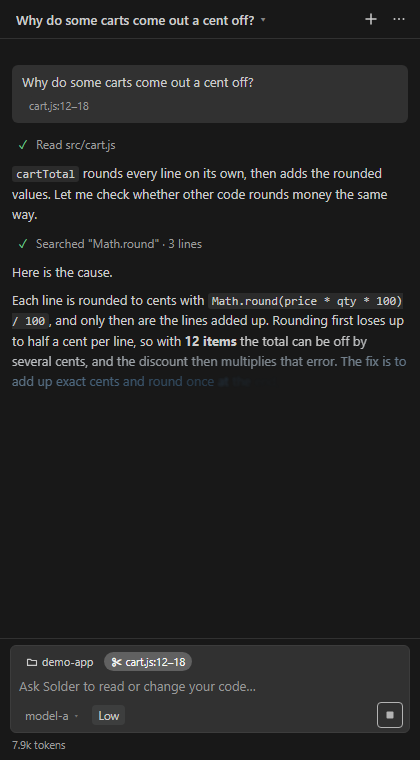
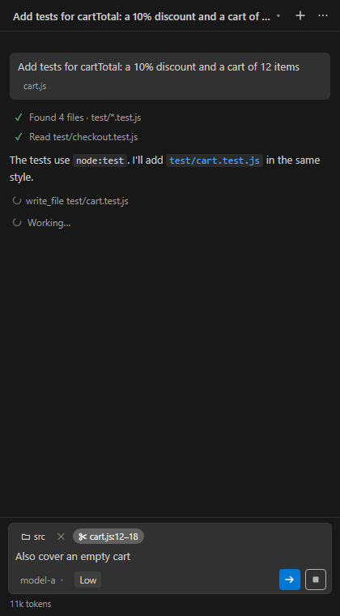

# Solder

A lean coding agent that lives in a VS Code side panel. It works with any OpenAI-compatible Chat Completions endpoint that supports tool calling.

Solder is for people who want an agent beside the editor, not instead of it:
- **9 tools:** `read_file`, `symbols` (outline, definitions, references), `search`, `find_files`, `changes` (git), `edit_file`, `write_file`, `remove_item` and `problems`. No shell: Solder reads and edits code, and tells you what to build or test.
- **Docs search:** point the `solder.docsFolders` setting at your own reference folders, or use **Use as Solder docs** on a folder in the Explorer, and `search` with `docs: true` looks there too. They're indexed on your PC.
- **VS Code's own diff and undo** for every edit.
- **An approval** before any change outside the workspace.
- **Follows `AGENTS.md`**, plus a few rules you set.
- **A token meter** that shows what each answer costs.

**Status: early (0.0.1).** The panel, the agent loop and the tools work; build the `.vsix` with `node build/vsix.js`. See [docs/DESIGN.md](docs/DESIGN.md) for the plan and [docs/LESSONS.md](docs/LESSONS.md) for the engine lessons it's built on.

## Screenshots

A finished chat, with Review and Undo on the edit:

A reply streaming in, and a step running while you type the next message:

 

## Try the connection check

1. Install the `.vsix`: `code --install-extension solder-0.0.1.vsix`. For development, open this folder and press F5.
2. Settings → Solder: set **Endpoint** (the full `/chat/completions` address).
3. Command palette → **Solder: Set API key**.
4. Command palette → **Solder: Check connection**. It lists the models, then makes one tool round trip and reports each step in the Solder output.

## Rules for changing Solder

- **No npm packages**, not even for development. Plain JavaScript with `// @ts-check` and JSDoc; Node built-ins and the `vscode` API only.
- **Nothing deployment-specific in this repo:** no company or gateway names, addresses, model names, keys or logs. Those go in user settings or org policy, and private notes stay out of the repo (`private/` is ignored).
- **Contact only the configured endpoint.** No telemetry, no other network calls.
- **Every model-facing text** lives in `src/prompt.js` and is pinned by a test.
- **Tests:** `node --test`. With no Node installed, use VS Code's own: `$env:ELECTRON_RUN_AS_NODE=1; & "<VS Code>\Code.exe" --test`.
