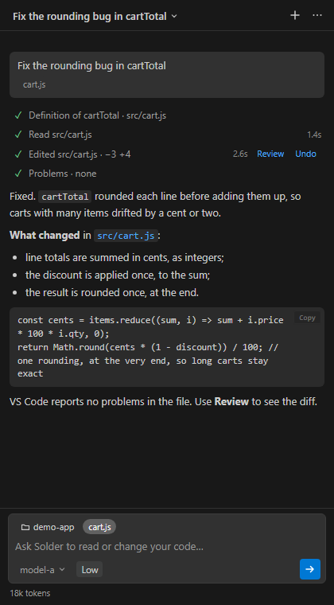
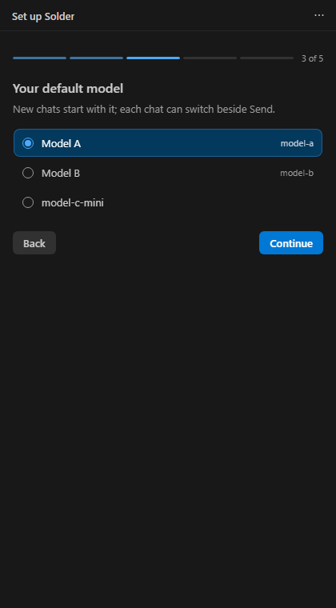
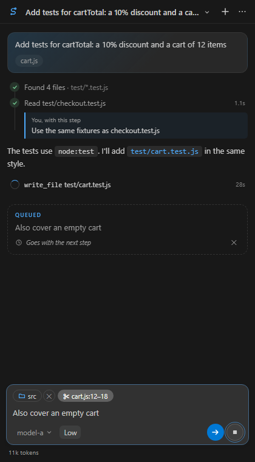

# Solder

**A lean coding agent beside your editor.** Solder sits in VS Code's side bar and reads, searches and edits the code in your workspace. It talks to any OpenAI-compatible Chat Completions endpoint that supports tool calling, such as your company's gateway or a server on your own PC, and to nothing else.

## Getting started

1. **Install it:**
   - **from the Marketplace:** search for **Solder** in VS Code's Extensions view;
   - **or from a `.vsix` file**, for a PC that can't reach the Marketplace: in the Extensions view, choose **⋯ → Install from VSIX…**, or run `code --install-extension solder-<version>.vsix`.

   Solder needs VS Code 1.100 or later. Docs search also needs SQLite in VS Code's runtime, which recent versions have. If yours doesn't, Settings says so.
2. **Run the guided setup.** Solder offers it the first time it starts. You can also run it any time from the panel's **⋯ menu → Guided setup…**. It asks for:
   - **your gateway's address:** the full Chat Completions URL, ending in `/chat/completions`;
   - **your API key:** kept in VS Code's secret storage, never in settings. Solder checks it by listing the models;
   - **your default model;**
   - **your own docs folders:** optional, see [Your docs](#your-docs);
   - **a few rules about you and your code:** optional, for example "We target Python 3.10" or "Never edit files under `generated/`".
3. **Ask.** Type in the box at the bottom and press **Enter**; **Shift+Enter** adds a new line. Or pick one of the cards on a new chat: summarise the codebase, explain or fix a script, clean up, learn something, review your changes, or ask what Solder can do.

## Using Solder

- **What it looks at.** Chips above the box tell Solder where you are:
  - **The working folder:** relative paths and searches start there. Click the chip to change it, or right-click a folder in the Explorer and choose **Work in this folder**.
  - **The open file, or your selection:** click a chip to include it, or click it again to leave it out.
- **While it works,** each step shows as a line with how long it took. Click a line to see its output. If you type something meanwhile, the message is **queued** and goes with the next step. Its ✕ takes it back.
- **From the editor:** select some code, right-click, and choose **Solder → Explain this**, **Fix this** (it sends the problems VS Code shows in the selection too) or **Add to chat** (the selection goes with your next message).
- **Every edit can be reviewed and undone.** **Review** opens VS Code's diff of that step. **Undo** puts the file back as it was, and Solder is told with your next message. VS Code's own **Ctrl+Z** works too.
- **It asks first** before:
  - deleting anything;
  - changing a file outside the workspace, or one with unsaved changes;
  - changing git's or VS Code's own files (`.git`, `.vscode`, `.gitattributes`), where a change can make programs run;
  - reading a file outside the workspace and your docs folders.

  You can add a note for the model when you answer.
- **Slash commands.** Type **/** in the box for the list; the arrow keys move, **Enter** or **Tab** picks one, **Esc** closes it:
  - **/new** starts a new chat, and **/fork** carries on in a copy of this one (the original stays as it was);
  - **/compact** summarises the chat now to save tokens; add what matters most, as in `/compact the API names`;
  - **/rename**, **/model** and **/effort** change this chat's name, model or effort, as in `/effort high`;
  - **/review** reviews what's changed since the last commit; **/settings** opens the settings; **/help** opens this guide.
- **Stop and Resume.** **Stop** (or **Esc**) ends the reply. After a stop, or a connection problem, **Resume** carries on from the last finished step, so nothing that's done is lost.
- **Models and effort.** The model picker beside Send switches models for this chat. **Low / Medium / High** sets how hard the model thinks: High is slower and uses many more tokens.
- **Settings** (⋯ → Settings) open right in the panel: the connection, the model and effort, your docs folders (with how far indexing has got), rules, and cost. Each field saves as you leave it.
- **Chats** are saved per workspace. The title menu lists them: pinned ones first, then by age (today, the last 7 days, the last 30 days, older), with archived ones folded away at the end. **Right-click** a chat there (or press **Shift+F10**) to pin, rename, fork, archive or delete it. Solder names each chat after its first answer, and again after the third; a name you give it is kept.

 

## What it can do

Solder has ten tools, and no shell. It never runs commands: when something needs building or testing, it says what to run, and you run it.

| Tool | What it does |
|---|---|
| `read_file` | Reads a file, or a range of lines. It sees unsaved changes, and reads Word, Excel and PowerPoint files as text. |
| `symbols` | A file's outline (classes, functions, methods), or where a name is defined and every place it's used, from VS Code's language support. |
| `search` | Searches the workspace, or your docs folders. |
| `find_files` | Lists files matching a pattern. |
| `changes` | Shows what's changed in git since the last commit. |
| `edit_file`, `write_file` | Changes or writes a file (creating any folders it needs), then reports any new errors VS Code finds in it. |
| `move_item` | Moves, renames or copies a file or folder, creating any folders it needs. It never overwrites, and lists the lines that still use the old path so they get fixed. It can be undone. |
| `remove_item` | Deletes a file or folder, after asking. It can be undone. |
| `problems` | Lists the errors and warnings VS Code shows. |

## Your docs

Point Solder at folders of reference documentation that only exist on your PC: in-house APIs, schematics, specifications. The model then searches them when a task needs them.

- **Add a folder:** in the guided setup; with **Use as Solder docs** on a folder in the Explorer; or in the **Docs folders** setting. Each folder can have a short note on what's in it, which tells the model when to look there.
- **What's searched:**
  - any plain text: `.txt`, `.md`, `.rst`, `.html`, `.xml`, `.json`, `.yaml`, `.csv`, `.log`, and code and headers such as `.c`, `.h`, `.py`, `.cs` and `.ps1`, in UTF-8 or UTF-16;
  - Word, Excel and PowerPoint files: `.docx`, `.xlsx`, `.pptx`, and their macro versions.
- **What isn't:**
  - PDFs, images and scans;
  - the old `.doc`, `.xls` and `.ppt` formats;
  - files over 5 MB (40 MB for Office files);
  - anything beyond 20,000 files in one folder. `.git` and `node_modules` are skipped.
- **Privacy:** the index is built and kept on your PC, and refreshed in the background. Only the passages the model reads are sent to your endpoint.

## Instructions it follows

- **`AGENTS.md`:** if your workspace has one at its root, Solder follows it. One in a subfolder applies once Solder reads files there. The **Instruction files** setting adds others, such as `CLAUDE.md`.
- **Your rules:** a few plain lines in the **Rules** setting, or in the guided setup, added to every chat.

## Tokens and cost

Each step sends the whole chat again, so long chats cost more per step. Solder keeps that down:
- it cuts old tool output down to short stand-ins;
- it leaves out earlier turns' big file writes;
- it summarises the older part of a chat once it passes **Compact at tokens**, 100,000 by default.

The panel shows what the chat has used, and the status bar shows the allowance left when your gateway reports one. **A new chat for each new task is the cheapest habit.**

## Settings

| Setting | What it's for |
|---|---|
| **Endpoint** | your gateway's `/chat/completions` address |
| **Model**, **Model filter**, **Model names** | the default model; which models are offered; short names for the picker |
| **Effort** | how hard new chats think |
| **Compact at tokens** | when the older part of a chat is summarised |
| **Max rounds** | the most steps with tool calls for one message |
| **Rules**, **Instruction files** | what the model always follows |
| **Docs folders** | your own reference docs |
| **Storage limit GB** | the most disk space Undo's backups may use, 5 GB by default; past it, the oldest go first |

The API key is set with **Solder: Set API key**, or in the guided setup. It's never stored in settings.

## Privacy

- **Network:** Solder contacts only the endpoint you set. There's no telemetry, no update check and no other network call, and the panel loads nothing from the internet. **⋯ → Send feedback…** opens your own email app, addressed to support, with only the Solder and VS Code versions filled in.
- **Your key:** kept in VS Code's secret storage.
- **Your chats and the docs index:** stay on your PC, in VS Code's storage for Solder.

## Troubleshooting

- **"Can't reach the endpoint":** run **Solder: Check connection** from the command palette. It lists the models, then makes one tool round trip, and reports each step in the Solder output.
- **"The allowance is used up":** your gateway's daily limit was reached. Everything so far is saved, so choose **Resume** once it resets.
- **The outline or symbols come back empty:** VS Code has no language support for that kind of file, or it's still starting. Solder falls back to text search.

## Contributing

See [CONTRIBUTING.md](CONTRIBUTING.md). To report a security problem, see [SECURITY.md](SECURITY.md). Solder is MIT licensed, and what's changed is in [CHANGELOG.md](CHANGELOG.md).
